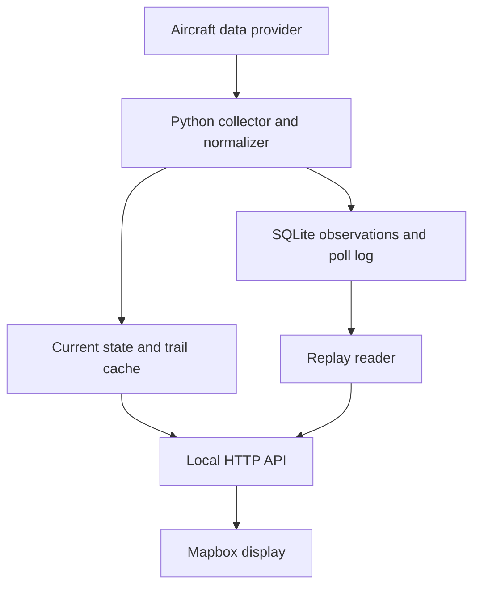

# Airspace: plan and development notes

The original technical plan (prepared October 17, 2026, as SPEC.md), with the decisions made while building each milestone and notes on how the pieces work. The [README](README.md) covers installing and using the tool.

**Status:** milestones 1–4 are built. Milestone 5's soak test is running (see [5. Decide on continuous operation](#5-decide-on-continuous-operation)).

## Objective

Build a local dashboard that answers: “What is flying near my house right now?” A Python service collects nearby aircraft positions, keeps a short history and supplies a radar-style Mapbox display. The initial use case is West Los Angeles near LAX, with particular attention to helicopters and low-altitude traffic.

The first deliverable is a collector and a coverage report. A useful map depends on timely positions for the aircraft that matter, especially helicopters. Proximity to LAX alone does not establish coverage quality.

## Guiding principles

- Use one geographic request per polling cycle rather than one request per aircraft.
- Keep collection independent of the map and browser lifecycle.
- Make timestamps, missing values and outages visible.
- Keep observed positions separate from animation and inferred events.
- Put provider-specific parsing behind a small interface.
- Start with a local, personal application. Revisit data permissions before commercial use; adsb.fi's terms are personal and noncommercial only, so a CNN newsroom deployment needs a different arrangement.
- Use FlightTracer where inspection shows useful reusable code; keep it optional for live tracking.

## Initial scope

Include a configurable home point, circular area, altitude filter, aircraft markers, recent trails, aircraft details, local recording and replay. Support a custom polygon after the circular version works. Show registration, callsign and aircraft type when available; unknown values remain unknown.

Defer origin/destination enrichment, airline schedules, notifications, multiple households, accounts, cloud hosting and dedicated display hardware. Do not promise identification of every aircraft or uninterrupted tracking.

## Data-source decision

Start with **adsb.fi**, subject to validating its response schema and local coverage. Its documentation provides a nearby-aircraft endpoint, permits personal noncommercial use and requires attribution. The public limit is one request per second; begin at one request every 10 seconds. The documented endpoint is:

```text
GET https://opendata.adsb.fi/api/v3/lat/{latitude}/lon/{longitude}/dist/{radius_nm}
```

Use v3 for geographic queries; the provider marks the older v2 geographic endpoint as deprecated. The v3 radius is capped at 250 NM. Requests returning 400, 401, 403, 404 or 429 count toward the rate limit and excessive invalid requests trigger a temporary IP restriction, so non-429 client errors pause collection instead of retrying. Do not assume a particular response field exists until a real response is captured and checked. [1]

### First captured response

One request on October 17, 2026 (approximate LA demo center, 10 NM) returned HTTP 200 in 0.29 seconds with 54 aircraft. One snapshot is not a coverage measurement, but it settles these schema points, which adapter fixtures must cover:

- Top level: `ac`, `msg`, `now` (epoch milliseconds), `total`, `ctime`, `ptime`.
- `seen_pos` and `seen` are seconds before `now`, so `position_at = now/1000 - seen_pos` with basis "derived from documented age."
- `alt_baro` is an integer or the string `"ground"` (33 of 54 records near LAX).
- `type` gives the position source: `adsb_icao`, `adsr_icao`, `tisb_trackfile` and, by readsb convention, `mlat` and others. Map it to `position_source`.
- `hex` carries a `~` prefix for non-ICAO addresses such as TIS-B track files.
- `flight` is space-padded. `r`, `t`, `desc`, `ownOp` and `year` come from the provider's aircraft database and may be absent.
- `category` was present on 52 of 54 records. All three helicopters (two LAPD AS350s and an R44) reported `A7`.
- `track` was absent on 27 records, all on the ground.
- `dst` and `dir` are distance and bearing from the query point. Compute distance locally instead, and strip both from committed fixtures because they reveal the query center.

| Provider | Intended role | Decision before use |
| --- | --- | --- |
| adsb.fi | First personal prototype | Validate schema, freshness and helicopter coverage; retain attribution |
| ADSB.lol | Alternative adapter | Recheck access, limits and ODbL requirements; its documentation asks production users to contact it [2] |
| ADS-B Exchange | Potential paid source | Verify current plan, request allowance, authentication and permitted storage/use [3] |
| Local receiver with readsb | Later independent collection source | Evaluate antenna location and actual reception; readsb exposes aircraft JSON [4] |

Do not silently combine providers initially. Switch explicitly and record the source. Different providers may report different observation times, positions and metadata for the same aircraft.

At 10-second polling, continuous collection makes 8,640 requests per day or 259,200 per 30-day month, before retries. A two-hour trial makes 720 scheduled requests. API request frequency and underlying position refresh frequency are separate measurements.

## Architecture

Use a single Python process for the first version: a FastAPI application with one background collector, an in-memory current-state cache and SQLite persistence. Serve the built frontend from the same origin. Run exactly one application worker and disable development auto-reload during recording so multiple collectors cannot start accidentally.



The provider adapter returns normalized observations and poll metadata. Collection, persistence, geographic filtering and rendering do not depend on the provider's native response shape.

Proposed stack: Python 3.12+, uv, HTTPX, Pydantic, FastAPI, SQLite through the standard library, Typer and pytest. Frontend: Svelte 5 with TypeScript, Vite, Mapbox GL JS and CSS. Decided October 17, 2026, over plain TypeScript: the aircraft list, detail panel, filters and replay timeline carry enough shared UI state to justify a framework, and Svelte matches the team's dailygraphics rig. Resolve supported dependency versions during implementation and commit lockfiles. Use PyProj for geodesic calculations and Shapely when polygon support is added; pandas and GeoPandas can remain optional analysis tools.

## Collection and normalization

Each polling cycle should:

1. Request all aircraft within a collection circle that contains the display area plus a configurable buffer.
2. Record request start, response receipt, status, latency and any provider timestamp.
3. Validate the top-level response. Quarantine invalid aircraft records individually and count them.
4. Normalize timestamps, units, aircraft identifiers and optional fields.
5. Persist accepted observations and update the current-state cache only with newer position observations.
6. Rebuild recent trails from observations, then expose one consistent state snapshot.

Use a monotonic clock to schedule polls and UTC for stored timestamps. On macOS, `time.monotonic()` does not advance during sleep, so detect sleep by comparing elapsed wall-clock and monotonic time between polls; record a gap row in the poll log and resume on the normal schedule. Set an HTTP timeout shorter than the polling interval. Allow one request in flight at a time. Honor `Retry-After`; use capped exponential backoff with jitter for transient failures. Pause and report persistent authentication or schema errors. Do not interpret a failed request as an empty sky or issue catch-up bursts after laptop sleep.

The normalized record should contain:

| Field | Meaning |
| --- | --- |
| `provider`, `aircraft_id` | Provider and source aircraft identifier; retain non-ICAO prefixes |
| `received_at`, `provider_at`, `position_at` | UTC receipt, response and position times; nullable where unavailable |
| `position_time_basis` | Explicit timestamp, derived from documented age or unknown |
| `latitude`, `longitude` | WGS84 position in degrees |
| `altitude_baro_ft`, `altitude_geom_ft` | Separate altitude values, each nullable |
| `on_ground` | Boolean or unknown; preserve the provider's ground sentinel correctly |
| `ground_speed_kt`, `track_deg`, `vertical_rate_fpm` | Movement fields with explicit units |
| `callsign`, `registration`, `aircraft_type`, `category` | Optional identification and classification |
| `position_source` | ADS-B, MLAT or another source when supplied |

Preserve zero speed, zero altitude and zero-degree track as valid values. Strip callsign whitespace. Do not derive helicopter classification from speed or flight pattern; use a documented category or aircraft metadata, with an unknown fallback.

Classification order:

1. ADS-B emitter category `A7` means rotorcraft.
2. Otherwise, look up the ICAO hex in the FAA registry through hangarbay's local DuckDB (`aircraft_decoded.mode_s_code_hex` joined to `aircraft_make_model.type`): type `6` is rotorcraft and `9` is gyroplane. This covers only US-registered aircraft and is as current as the local registry snapshot.
3. Otherwise, unknown.

Record which rule produced the classification. Hangarbay is an optional dependency, opened read-only and never queried inside the polling loop; enrichment runs at report time or behind a per-aircraft cache.

Categories `C1` through `C5` are surface vehicles and obstacles (LAX emergency and service vehicles appear in the feed). Store them, but exclude them from the map, aircraft counts and coverage metrics unless a filter includes them.

TIS-B track files can duplicate an aircraft that also broadcasts ADS-B. Do not merge records across identifiers; the coverage report flags likely pairs (nearby positions with matching track in the same poll).

For readsb-style data, `seen_pos` measures age of position and `seen` measures age of any message. Use position age for marker freshness. [4] Timestamp units must be defined by each adapter and covered by fixtures; never apply one seconds/milliseconds assumption to every provider. Future or inconsistent times should be flagged rather than treated as fresh indefinitely.

## Airspace definition

Keep the home point in a local configuration file excluded from Git. Require the user to supply the actual coordinates; do not infer a street address. Provide an explicitly approximate LA demo center for fixtures and screenshots.

Suggested defaults, adjustable after the trial:

| Setting | Proposed default |
| --- | --- |
| Visible radius | 5 statute miles |
| Collection radius | 10 nautical miles |
| Poll interval | 10 seconds |
| Trail duration | 5 minutes |
| Fade threshold | Position age over 20 seconds |
| Hide threshold | Position age over 60 seconds |
| Trail gap threshold | 30 seconds |
| Altitude filter | Off initially; optional “below 10,000 ft barometric” preset |

Calculate radial membership geodesically. Convert miles and nautical miles explicitly. For polygons, validate a WGS84 Polygon, include boundary points and query a containing circle; apply the precise polygon filter locally. Reject settings whose visible area exceeds the collection footprint until that footprint is expanded within provider limits.

Keep unknown-altitude aircraft visible by default with a labeled filter option. Barometric altitude is not height above ground. Track direction is not necessarily aircraft heading. Avoid labels that imply otherwise.

## State, trails and persistence

Create three SQLite tables:

- `sessions`: configuration snapshot, source, start/end times and schema version.
- `polls`: session ID, receipt time, provider time, HTTP status, latency, accepted/rejected counts and error summary.
- `observations`: poll ID and the normalized fields above, plus a flag indicating a newly advanced position time.

Index observations by `(session_id, aircraft_id, position_at)` and polls by session/time. Enable WAL mode and batch each poll's inserts in a transaction. Save a record for each returned observation so replay can reproduce availability; avoid adding duplicate position timestamps to trails. If position time is unknown, keep the record but mark freshness unknown and avoid inventing precise observation timing.

An aircraft missing from one response is not automatically an exit. Age the cached position. Report an area exit only when consecutive fresh observations establish inside-to-outside movement; otherwise report “last seen.” Split trails across missing intervals and implausible jumps. Never connect a long coverage gap with an apparently continuous observed route.

Keep normalized records for seven days by default, with an explicit archive option. Store compressed raw responses only during a bounded diagnostic trial, outside Git, subject to source permissions. Keep them for the whole milestone 1 trial; at roughly 50 KB per uncompressed response, two hours is about 36 MB before compression. Measure database growth during the trial before choosing longer retention. Aircraft identity is not a unique flight ID; any later flight/session segmentation needs a separate rule.

## Local API and frontend

Proposed endpoints:

| Endpoint | Response |
| --- | --- |
| `GET /api/state` | Versioned current snapshot, aircraft, trails, active area and feed status |
| `GET /api/aircraft/{id}` | Available metadata and recent observations |
| `GET /api/sessions` | Recorded sessions |
| `GET /api/replay?session_id=...&at=...` | State reconstructed at a recorded receipt time |
| `GET /api/health` | Collector status, last success, last error and observation age summary |

Start with browser polling every two seconds against the cached local state; it must not trigger provider requests. Consider server-sent events only if useful later. Replay must use only records received by the selected replay time and must never alter live collection state. Reuse the same normalization and state-building functions for live and replay paths.

Build a north-up Mapbox display with a dark basemap, distance rings, visible area boundary, aircraft symbols rotated by ground track and short trails. Aircraft without a track get an unrotated symbol rather than falling back to heading. Owner/operator (`ownOp`) is stored but left out of the default detail panel; it can name private individuals. Use distinct helicopter symbols only when classification is supported. Provide an aircraft list sorted by distance, a selected-aircraft detail panel, altitude controls and a prominent last-update/feed-status indicator. Use Inter (matching the Mapbox style) with a system-font fallback and sentence case labels.

Use GeoJSON symbol and line layers rather than one DOM marker per aircraft. Coordinates are always `[longitude, latitude]`. Update existing sources without rebuilding the map. Keep observed markers authoritative; optional animation should interpolate buffered observations, stop on stale data and never create stored positions.

Keep the server bound to `127.0.0.1`. Serve UI and API from the same origin. Keep provider credentials server-side. A Mapbox public token is browser-visible; restrict it appropriately. Local operation still requires internet for provider access and typically Mapbox assets, and Mapbox usage terms/billing still apply. Replay removes the live-data requirement, not necessarily the basemap connection.

## FlightTracer integration

Inspect a fresh checkout before choosing imports: the publicly retrievable README may lag the current package. It describes trace fetching, geographic processing and exports. [5]

Evaluate reusable identity handling, timestamp parsing, metadata lookup, export conventions and gap handling. Check dependency cost before importing plotting or geospatial modules into the polling loop. Live geographic discovery remains an explicit new responsibility unless current code already implements it.

Keep the live app in a separate repository initially. Add an optional “export for FlightTracer” path only after verifying its actual input contract. A later action could retrieve a selected aircraft's longer history through supported access, but it must not issue historical requests every live polling cycle.

## Proposed command-line interface

These commands describe the intended interface; they are not implemented yet.

```bash
uv sync
uv run airspace init
uv run airspace collect --duration 2h
uv run airspace report --session latest
uv run airspace serve
uv run airspace replay --session latest
```

`init` writes a configuration template and prompts for coordinates. `collect` is a headless process. `serve` starts the local collector and dashboard, refusing to start a second collector against an active session. `replay` serves recorded data with live acquisition disabled. Use a process lock, not just a UI assumption, to prevent duplicate collection.

Suggested modules: `config.py`, `models.py`, `providers/base.py`, `providers/adsbfi.py`, `collector.py`, `geometry.py`, `state.py`, `storage.py`, `replay.py`, `api.py` and `cli.py`, plus `web/` and `tests/fixtures/`. Keep provider adapters small; introduce more abstractions only when a second provider needs them.

## Implementation milestones

### 1. Establish data access and coverage

Implement configuration, the adsb.fi adapter, recording and a headless report. Capture two hours spanning useful local traffic, then sample another time window if helicopter observations are insufficient. Save a schema fixture with sensitive location/configuration removed.

Report request success, latency, duplicate/cached positions, position-age median and p95, unique aircraft, known helicopters (with classification rule), null fields, observation gaps, possible TIS-B duplicates, sleep gaps and estimated storage per hour. Separately note visible or audible aircraft missing from the feed; that is an informal check, not a complete denominator.

Proposed gate: at least 95% scheduled requests succeed, p95 known position age for airborne (or unknown-ground-state) traffic inside the visible area is at most 20 seconds and a helicopter of interest is observed with useful continuity. These are project targets, not provider guarantees. Parked aircraft at LAX report positions rarely and would otherwise dominate the age distribution; the report still shows all-traffic age and a breakdown by position source. A 45-second smoke test showed TIS-B track files aging to 45 seconds while staying in the feed, so watch that breakdown during the trial. If the trial contains no relevant helicopter traffic, that criterion remains untested. Change source or test window before investing heavily in presentation.

### 2. Build the live state service

Implement geographic filtering, trails, freshness, SQLite transactions and API snapshots. Verify single-collector behavior, bounded memory and recovery from request failures and laptop sleep. Replay recorded fixtures through the same state builder.

Built October 17, 2026. Decisions made during implementation:

- Position age at snapshot time is the provider-reported age at the response plus local time since receipt, so the provider's clock is never compared with the local one.
- Trails split when consecutive positions are more than the trail gap threshold apart or imply a speed above 800 knots.
- Entry and exit events need two consecutive fresh positions (each within the fade threshold at receipt) on opposite sides of the boundary, with no trail break between them. Everything else is "last seen."
- Aircraft past the hide threshold move from `aircraft` to `last_seen` in the snapshot. Tracks are dropped from memory once nothing has been received for max(trail duration, hide threshold).
- Display filters (altitude, surface vehicles) are applied by the client from the full snapshot, so they can never cause provider requests.
- Replay rebuilds from max(trail duration, hide threshold) plus the trail gap of history before the requested time and takes the true last success from the full poll log. Tests confirm that replay matches the live snapshot (visible aircraft, freshness, ages, trails and feed status) at several moments, including during an outage.

### 3. Build the Mapbox display

Add rings, markers, trails, selection, filters and feed status. Verify that marker orientation, distance units, timestamps and unknown values agree with recorded observations. Changing a display filter must not multiply provider calls.

Built October 17, 2026. Decisions made during implementation:

- Basemap is Mapbox's public `dark-v11`; the team's `cnndigital` styles aren't reachable with a personal token. Mercator, north-up, rotation disabled.
- Symbols are SDF images drawn on a canvas so the style can color them. Altitude labels use hundreds of feet.
- On-ground aircraft and surface vehicles are hidden by default. At LAX they outnumber airborne traffic and age poorly. Unknown-altitude airborne traffic stays visible.
- The client re-ages positions between polls with the server's thresholds, and sorts the list by distance itself.
- Any failure (provider, collector pause or local server) sets an untrusted state: red header, grayscale map and an empty-list message that points to the status. Replay shows the recorded feed status.
- The interim replay entry point is `?session=&at=` on the dashboard URL.
- Verified in headless Chromium against live data at the demo center and against replay of the first trial: marker rotation matches recorded tracks, selection survives polls, a sleep-gap moment shows "no current data," and the browser made only local API requests.

### 4. Add replay and exports

Provide session selection, a timeline and pause/speed controls. Export documented JSON/GeoJSON with source and timestamp provenance. Add optional FlightTracer compatibility after inspecting its current interfaces.

Built October 17, 2026. Decisions made during implementation:

- The timeline endpoint (`/api/sessions/{id}/timeline`) returns per-poll outcomes as epoch-millisecond arrays, plus sleep gaps. Its helicopter strip counts ADS-B category A7 only.
- Playback advances a client playhead and keeps at most one `/api/replay` request in flight, always for the latest playhead. Pausing or seeking writes `?session=&at=` to the URL.
- Exports (JSON, GeoJSON tracks, GeoJSON points) carry a provenance `metadata` block with source terms, session, range, timestamp definitions and coverage gaps. They omit the home point and distances from home. Track segments use the same break rule as map trails, through a shared function.
- FlightTracer compatibility is a run folder (`trace.csv` plus `airspace.json`) for one aircraft. It was checked against FlightTracer v0.4.2 by rendering N224LA from the first trial with `flight-tracer render`. FlightTracer hardcodes an ADS-B Exchange source credit on its images, so the fix belongs in FlightTracer (read a source from the run folder).
- The map uses the stiles Mapbox Standard dark style, overridable with `VITE_MAPBOX_STYLE`. Overlay layers set emissive strength 1 so Standard's night lighting doesn't darken them. Map labels borrow the style's own font stack, and the interface uses Inter, replacing Roboto.
- Follow-up the same day: the Standard style read as too busy, so the default went back to `dark-v11`, recolored at load into a radar scope (`lib/basemap.ts`, by layer type and id pattern; Standard styles are left alone). One palette serves the map (`lib/theme.ts`) and the interface (CSS variables): phosphor green for aircraft and rings, amber for helicopters, cyan for selection and home. Callsigns use JetBrains Mono. Trails use a line gradient as an afterglow. There's deliberately no rotating sweep, which would imply radar-scan data rather than 10-second polls.
- Further polish: a map legend (symbols, rings, the altitude label convention), hover cards over aircraft, and a compact layout for a small always-on window. Compact drops the side panel and replay extras but keeps the feed status, the count and the adsb.fi credit; the selection keeps its card open since there's no detail panel. Display preferences live in `localStorage`.

### 5. Decide on continuous operation

Run an eight-hour soak test after the shorter milestones pass. Inspect memory, database growth, request counts and reconnection behavior. Only then decide whether the API is sufficient or a local receiver would be worthwhile. Hardware selection follows a reception/antenna assessment; MLAT-only position recovery generally needs a receiver network, so one receiver does not guarantee complete helicopter coverage.

In progress: session 4, `airspace serve` under `caffeinate -i`, started October 18, 2026, 00:03 UTC and left running overnight. At 3 hr 47 min:

- 1,363 of 1,363 polls succeeded (latency median 258 ms, p95 340 ms), with no host sleep.
- Physical memory footprint flat at about 140 MB (peak 145 MB). RSS reads about 458 MB because it counts freed pages macOS hasn't reclaimed.
- 30 open files and two sockets (the API listener and one keep-alive connection to adsb.fi).
- SQLite grows 3.9 MB/hour and gzipped raw responses 1.2 MB/hour, about 120 MB/day together. The WAL stays near 4 MB, so checkpoints are keeping up.
- Airborne p95 position age in the visible area 5.5 s; 18 rotorcraft, most at 97–99% continuity.

Open items:

- Reconnection hasn't been exercised: the provider never failed. Test by dropping Wi-Fi for about two minutes.
- `storage.retention_days` is in the config but nothing enforces it, so the database grows without bound. Continuous operation needs pruning of old observations (and probably `store_raw = false`).
- Final readings after the overnight run, comparing the first and second halves for drift.

## Implementation notes

Details that matter when changing the code. Moved from the README.

### Collector

- One request at a time on a fixed schedule; a slow response delays the next poll rather than overlapping it.
- Non-429 client errors pause collection instead of retrying, because adsb.fi counts them toward its rate limit. So do `schema_error_limit` consecutive schema errors (default three).
- A 429 waits at least as long as `Retry-After`. Other failures back off exponentially with jitter, capped at `max_backoff_s`.
- Sleep detection: macOS stops `time.monotonic` during sleep, so the collector compares wall-clock and monotonic deltas. A sleep is recorded as a gap; missed polls are not made up.
- `fcntl.flock` on `data/collector.lock` keeps a second collector off the same data directory, whether it's `collect` or `serve`.
- Read-only connections (replay, reports) use `PRAGMA query_only=ON`. `mode=ro` fails once the writer has exited and the `-shm` file is gone.

### Report

The report prints the milestone 1 gate plus latency, cached and repeated positions, null-field rates, observation gaps, possible TIS-B duplicates (only `~` IDs, which are non-ICAO), position age by source and storage per hour. Surface vehicles (C1–C5) are excluded. Intervals that contain the midpoint of a sleep window count as spanning sleep and are reported separately, not as coverage gaps.

### API and state

- `serve` runs one collector inside the API process, bound to `127.0.0.1` with one worker and no auto-reload. Reading the API never triggers a provider request.
- Live state and `/api/replay` use the same state builder; replay reads through a read-only connection and sees only records received by the requested time.
- Feed status: `starting`, `live`, `delayed` (no success for longer than the fade threshold), `degraded` (latest poll failed), `stale` (no success for longer than the hide threshold) or `paused` (collection stopped on an error that needs attention).
- A `+` in an ISO time decodes to a space in a query string; `_parse_at` puts it back, and the CLI prints times with `Z`.

### Dashboard

- Svelte 5 (runes), TypeScript 6 (svelte-check doesn't support 7 yet), Vite and Mapbox GL JS 3.
- Map layers are created once on load; each update only calls `setData` on the GeoJSON sources. Tests assert this with a Mapbox mock.
- `lib/basemap.ts` recolors a classic style by layer type and id pattern, so it survives style revisions, and hides POI, transit and shield layers. Styles with imports (Mapbox Standard) are left alone.
- The palette lives twice, in `lib/theme.ts` for the map and as CSS variables in `App.svelte`; keep them in step.
- Overlays set `*-emissive-strength: 1` so Standard's night lighting doesn't dim them. `line-gradient` trails need `lineMetrics: true` on the source and can't vary color per feature, so each trail color has its own layer.
- Positions keep aging on the browser clock between polls, using the server's thresholds. If the local server stops responding, markers fade and disappear instead of freezing.
- The map resizes with its container (compact mode, the replay bar) and refits the visible area when the layout switches.
- Browser checks use Playwright with the cached Chromium and SwiftShader flags (`--use-angle=swiftshader --enable-unsafe-swiftshader`), against live data and replays of session 1.

### Test fixture

`tests/fixtures/adsbfi_v3_la.json` is a real adsb.fi v3 response captured October 17, 2026, at the demo center. The `dst` and `dir` fields were removed and owner names redacted.

## Validation that matters

- Adapter fixtures cover missing fields, ground altitude, zero values, unknown identifiers, malformed records and timestamp units.
- Geometry checks cover known distances, circle boundaries, polygon boundaries and reversed-coordinate mistakes.
- State tests cover duplicate/out-of-order observations, stale positions, disappearance without confirmed exit and discontinuous trails.
- Failure tests cover 429 with `Retry-After`, timeouts, invalid JSON and a successful response containing no aircraft.
- Replay at a chosen time cannot see records received later; reconstructing a recorded live snapshot produces the same visible aircraft and freshness state.
- Browser checks cover selection, filters, status transitions and repeated updates without recreating map layers or losing selection.

An outage must leave a visible outage/stale indicator. It must never look like reliable evidence that no aircraft are nearby.

## Sources and remaining checks

Documentation checked October 17, 2026. Provider policies and interfaces can change. This plan has not made a live geographic API request or tested LA coverage. Pin implementation decisions to captured responses and a fresh dependency/repository inspection.

1. [adsb.fi open data API: endpoints, limits and terms](https://github.com/adsbfi/opendata/blob/main/README.md)
2. [ADSB.lol API documentation](https://api.adsb.lol/docs) — previously retrieved documentation describes free access and ODbL; a subsequent check returned 503, so recheck before implementing this adapter.
3. [ADS-B Exchange developer hub](https://www.adsbexchange.com/community/developer-hub/) and [geographic API documentation](https://www.adsbexchange.com/api/aircraft/v2/docs)
4. [readsb JSON format](https://github.com/wiedehopf/readsb/blob/dev/README-json.md)
5. [FlightTracer repository](https://github.com/stiles/flight-tracer)
6. [The Flight Wall FAQ](https://theflightwall.com/pages/faq)

The next engineering task is milestone 1: a headless collector, real response fixtures and a coverage report. That establishes whether the chosen feed supports the neighborhood display before frontend work begins.
