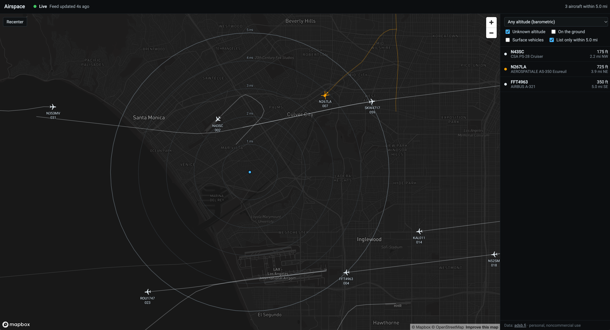

# Airspace

What's flying near home right now? Airspace is a local aircraft tracker. It polls the adsb.fi open data API for traffic around a home point, records it, and shows it on a radar-style Mapbox dashboard, with particular attention to helicopters and low-altitude traffic.



## Features

- **Live map:** aircraft within a configurable radius, rotated by ground track, with fading trails, altitude labels, mile rings, a legend and hover cards. Helicopters are amber.
- **Honest freshness:** positions age on screen between updates and fade, then disappear, when they go stale. Any outage turns the header red and grays out the map, so it never reads as an empty sky.
- **Helicopter classification:** ADS-B emitter category A7, then the FAA registry through [hangarbay](https://github.com/stiles/hangarbay) when it's installed.
- **Recording and replay:** every poll is stored in SQLite. Replay any session on a timeline that shows failed polls, laptop sleep and helicopter activity.
- **Exports:** JSON or GeoJSON (tracks or points) with provenance, and run folders for [FlightTracer](https://github.com/stiles/flight-tracer).
- **Coverage reports:** request success, position age, helicopter continuity, gaps and storage for any recorded session.
- **Compact mode:** a map-only layout for a small always-on window.
- **Local only:** one collector, one request every 10 seconds, an API bound to `127.0.0.1`. The browser never contacts the data provider.

## Requirements

- macOS or Linux, Python 3.12+ and [uv](https://docs.astral.sh/uv/)
- Node.js 20.19+ or 22.12+ to build the dashboard
- A public Mapbox token (`pk.`) for the map
- Optional: [hangarbay](https://github.com/stiles/hangarbay) with a downloaded FAA registry, for helicopter lookups beyond ADS-B category

## Quick start

```bash
git clone https://github.com/stiles/airspace.git && cd airspace
uv sync --extra enrich                  # drop --extra enrich to skip FAA registry lookups
uv run airspace init                    # prompts for home coordinates; writes airspace.toml

echo 'VITE_MAPBOX_TOKEN=pk....' > web/.env.local
cd web && npm install && npm run build && cd ..

uv run airspace serve                   # collector + dashboard at http://127.0.0.1:8000
```

`airspace init --demo` uses an approximate West LA center instead of prompting. `airspace.toml`, `web/.env.local`, `data/` and `web/dist/` are all gitignored. The token is built into the bundle, so restrict it to `http://127.0.0.1:*` in your Mapbox account.

## Usage

| Command | What it does |
| --- | --- |
| `airspace init` | Write `airspace.toml` with your home coordinates |
| `airspace serve` | Run the collector and the dashboard/API together |
| `airspace collect --duration 2h` | Record headlessly, without the dashboard |
| `airspace report --session latest` | Print a coverage report for a session |
| `airspace sessions` | List recorded sessions |
| `airspace replay --session latest` | Serve recorded data only, with no provider requests |
| `airspace export --format geojson` | Export a session (see below) |

Every command takes `--config` for a config file other than `airspace.toml`, and `--help` lists the rest. Only one collector can run against a data directory at a time, so `serve` refuses to start while `collect` is running, and vice versa.

### Long runs

macOS sleeps an idle laptop, and the collector records that as a gap rather than coverage. Wrap long runs in `caffeinate -i`, which blocks idle sleep while the command runs:

```bash
caffeinate -i uv run airspace serve
caffeinate -i uv run airspace collect --duration 8h
```

Closing the lid still sleeps most MacBooks; `caffeinate -s` also blocks system sleep, but only on AC power.

### Dashboard

- **Map:** the side list sorts aircraft by distance. Click an aircraft on the map or in the list for details: identity, type, altitude, speed, vertical rate, position source and age. Labels show altitude in hundreds of feet (`015` is 1,500 ft barometric).
- **Filters:** altitude presets, unknown altitude, on-ground aircraft and surface vehicles. Ground traffic is hidden by default to keep LAX out of the way. Filters run in the browser and never cause extra requests.
- **Compact:** the button in the header switches to a map-only layout; clicking an aircraft pins its hover card. Small windows start compact.
- **Replay:** use the Live/Replay switch. The timeline shows each poll (green succeeded, red failed, hatched while asleep) with an amber strip when a helicopter was in the feed. Drag to seek; space plays and pauses, ← and → step by poll, and the speed runs from 1× to 60×. The URL keeps `?session=&at=`, so any moment can be bookmarked.

To use a different Mapbox style, add `VITE_MAPBOX_STYLE=mapbox://styles/...` to `web/.env.local` and rebuild. Classic styles are recolored into the radar palette; Mapbox Standard styles keep their own colors.

### Exports

From the replay bar (a whole session) or the detail panel (one aircraft), or on the command line:

```bash
uv run airspace export --session latest --format geojson --geometry tracks -o tracks.geojson
uv run airspace export --format json --start 2026-10-17T19:00:00Z --end 2026-10-17T20:00:00Z -o hour.json
uv run airspace export --format flighttracer --aircraft a1f0d8 -o runs/n224la
```

Exports include source, terms and timestamp provenance and never include the home point. See [docs/exports.md](docs/exports.md) for the formats.

### API

`serve` exposes a read-only JSON API at `http://127.0.0.1:8000`, with interactive docs at `/api/docs`. Coordinates are always `[longitude, latitude]`.

| Endpoint | Returns |
| --- | --- |
| `GET /api/state` | Snapshot: aircraft by distance with freshness and trails, recently lost aircraft, entry/exit events, area and feed status |
| `GET /api/aircraft/{id}` | One aircraft with owner/operator and recent positions |
| `GET /api/health` | Collector status, feed status, a position-age summary and the process's memory |
| `GET /api/sessions` | Recorded sessions |
| `GET /api/replay?session_id=&at=` | Snapshot rebuilt from records received by `at` (ISO 8601) |
| `GET /api/sessions/{id}/timeline` | Per-poll outcomes and sleep gaps, for the replay bar |
| `GET /api/sessions/{id}/export` | JSON or GeoJSON download, with `geometry`, `aircraft` (comma-separated) and a time window |

## Configuration

`airspace init` writes `airspace.toml` with every setting and its default:

| Section | Key settings |
| --- | --- |
| `[home]` | `latitude`, `longitude`, `label` |
| `[area]` | `visible_radius_mi` (5), `collection_radius_nm` (10), `max_altitude_baro_ft` (initial filter preset) |
| `[collector]` | `poll_interval_s` (10), `timeout_s` (8), `max_backoff_s` (300), `store_raw` (false; keep gzipped raw responses) |
| `[freshness]` | `fade_s` (20), `hide_s` (60), `trail_gap_s` (30), `trail_duration_s` (300) |
| `[storage]` | `data_dir` (`data`), `retention_days` (7; 0 keeps everything) |
| `[enrich]` | `hangarbay_db`: path to hangarbay's registry; delete the line to turn lookups off |

The collector prunes recordings older than `retention_days` when it starts and every hour after, removing sessions it empties along with their raw files. SQLite grows about 3–4 MB/hour, so a week takes roughly 600 MB; `store_raw = true` adds about 1 MB/hour. Deleted space is reused rather than returned to the disk; run `sqlite3 data/airspace.sqlite VACUUM` with the collector stopped to shrink the file.

Each hour the collector also records its memory use, which `airspace report` shows as a trend.

## Helicopter classification

The classifier tries these in order and records which rule decided:

1. ADS-B emitter category `A7`.
2. FAA registry aircraft type, by ICAO hex, from hangarbay's DuckDB at `~/.hangarbay/data/publish/registry.duckdb`. Code `6` is rotorcraft and `9` is gyroplane. US-registered aircraft only, as current as your last `hangar update`.
3. Unknown.

Categories C1 through C5 are surface vehicles and obstacles, kept separate from aircraft.

## Development

```bash
uv sync --extra enrich
uv run pytest                    # backend

cd web
npm install
npm test                         # Vitest
npm run check                    # svelte-check and TypeScript
npm run dev                      # http://127.0.0.1:5173, forwards /api to airspace serve on :8000
```

```
src/airspace/      Python package: providers/, collector, state, storage, replay, API, exports, CLI
web/src/           Svelte 5 dashboard: components/, lib/ (API client, geometry, theme, replay)
tests/             pytest suite and a captured adsb.fi fixture
docs/exports.md    Export formats
PLANNING.md        Original plan, milestone decisions and implementation notes
```

Backend tests cover adapter edge cases, geometry, collector failure handling with a fake clock, state and trails, replay matching the live snapshot, exports and the API against a mock provider. Frontend tests cover formatting, filters, freshness, replay control and the app with a Mapbox mock. [PLANNING.md](PLANNING.md) has the design decisions and how things fit together.

## Data and terms

Aircraft data comes from [adsb.fi](https://adsb.fi), whose open data is for personal, noncommercial use and requires attribution, which the dashboard shows. Check the terms before any newsroom or commercial use. Coverage depends on volunteer receivers; aircraft can be missing, late or misidentified, and an empty map is not proof of an empty sky.

## License

[MIT](LICENSE)
