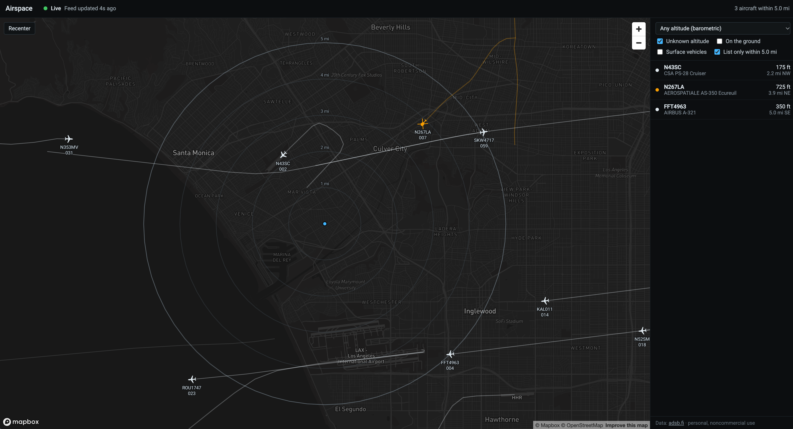

# Airspace

Airspace records aircraft near a home point and shows them on a radar-style map. It highlights helicopters, identifies known operators, and infers circling, hovering and low flight from recorded positions. Sessions go into a local SQLite database for replay, coverage reports and exports.



## Quick start

Install Python 3.12+, [uv](https://docs.astral.sh/uv/) and Node.js on macOS or Linux. Use Node 20.19 or later in the 20.x series, 22.13 or later in the 22.x series, or 24 or newer. Replace `pk.REPLACE_ME` with a public Mapbox token.

```bash
git clone https://github.com/stiles/airspace.git
cd airspace
uv sync
uv run airspace init

echo 'VITE_MAPBOX_TOKEN=pk.REPLACE_ME' > web/.env.local
npm --prefix web ci
npm --prefix web run build

uv run airspace serve
```

Open [the dashboard](http://127.0.0.1:8000/). `init` asks for home coordinates in decimal degrees, a label and a page title. Use `uv run airspace init --demo` for an approximate West LA center.

Use a dedicated public token for local development. The browser bundle includes it. Mapbox URL restrictions do not accept IP addresses or wildcards. If you restrict the token to `http://localhost:8000`, open the dashboard at that address. [Mapbox token documentation](https://docs.mapbox.com/accounts/guides/tokens/#url-restrictions)

`airspace.toml`, `web/.env.local`, `data/` and `web/dist/` stay out of Git. The collector and API run on the same machine and bind to `127.0.0.1`. The browser loads the basemap from Mapbox and reads aircraft and weather from the local API.

## Use the dashboard

- The list sorts aircraft by distance and shows its radius. Hover over a marker to highlight its row. Hover over a row or tab to it to highlight the marker and trail. Select a row for details and to bring an offscreen aircraft into view.
- **Activity** appears above the list when a listed aircraft is inferred to be circling or hovering. Select the behavior to frame it on the map. **Recenter** returns to the home view.
- Traffic beyond the home radius has shorter labels and thinner trails. Individual mile labels return as you zoom in. Open **Legend** for symbols and altitude codes such as `015`, which means 1,500 ft barometric.
- The filters control altitude, aircraft on the ground, surface vehicles and the list radius. Ground traffic is hidden by default. **Compact** switches to a map-only layout. Select a marker there to pin its card.
- Open **Weather** for the latest station observation, wind gusts, visibility and ceiling. Observations older than two hours are marked stale. Weather appears in live mode.
- Switch to **Replay** to seek through a recorded session. Green polls succeeded, red polls failed, hatching shows sleep gaps, and amber marks polls with an ADS-B category A7 aircraft. Space plays or pauses, and ← and → step by poll. The replay URL bookmarks the session and time.

## Record, review and export

Run these commands from the repository root.

| Command | What it does |
| --- | --- |
| `uv run airspace serve` | Collect data and serve the dashboard |
| `uv run airspace collect --duration 2h` | Record without the dashboard |
| `uv run airspace sessions` | List available recordings |
| `uv run airspace report --session latest` | Summarize coverage, freshness, gaps and detected behaviors |
| `uv run airspace replay --session latest --port 8001` | Replay a recording alongside the live server |
| `uv run airspace export --session latest --format geojson -o tracks.geojson` | Export recorded tracks |
| `uv run airspace catalog` | Validate operator catalogs and check them against the FAA registry when available |

Only one collector can write to a data directory at a time. Replay serves recorded data and makes no aircraft-provider requests. The API binds to loopback in both modes. Use [interactive API docs](http://127.0.0.1:8000/api/docs) for endpoints and parameters, or [the export guide](docs/exports.md) for formats and examples.

On macOS, `caffeinate -i uv run airspace serve` blocks idle sleep while recording. Closing the lid can still put the Mac to sleep. For an always-on monitor, see [Raspberry Pi setup](docs/pi-setup.md) and [kiosk installation and recovery](docs/raspberry-pi-kiosk.md).

## Configure the view

Airspace has three independent radii. Set them in `airspace.toml` and restart the server.

| Setting | Default | Controls |
| --- | --- | --- |
| `area.collection_radius_nm` | 10 nautical miles (11.5 statute miles) | How far out the collector asks the provider for traffic |
| `area.visible_radius_mi` | 5 statute miles | The home ring and the default aircraft list limit |
| `display.view_radius_mi` | Home radius plus 8% | The map framing on load and when you select **Recenter** |

Set `display.view_radius_mi` to match `area.visible_radius_mi` if you want Recenter to frame the list radius. Set `filters.list_visible_only = false` to list traffic throughout the collection area. Settings for the title, FAA registry, operator catalogs, polling, retention and the kiosk are in the [configuration guide](docs/configuration.md).

## Troubleshoot

- **The dashboard looks out of date or omits aircraft after a pull.** Run `npm --prefix web ci` and `npm --prefix web run build`, then refresh. The server serves the existing bundle until you rebuild it. A rebuild also applies changes to `web/.env.local`.
- **The live view looks empty.** Verify that you're in Live mode and check the feed status. Run `curl http://127.0.0.1:8000/api/health` from the machine running Airspace. If polls are succeeding, check the altitude and ground filters, the list radius and the map framing.
- **The basemap is blank.** Check the public token in `web/.env.local`, the allowed URL if your token has restrictions, and the internet connection. Rebuild after editing the token.
- **The collector is already locked.** Stop the other `serve` or `collect` process if you intend to take over recording. Use `replay` on a separate port to inspect a session while it runs.

## Development

```bash
uv sync --extra enrich
uv run pytest
npm --prefix web ci
npm --prefix web test
npm --prefix web run check
```

With `airspace serve` running on port 8000, run `npm --prefix web run dev` for the Vite dashboard on port 5173. Allow that port too if you use a URL-restricted Mapbox token.

The backend lives in `src/airspace/` and the Svelte dashboard in `web/src/`. See [the roadmap](PLANNING.md) for open work and design constraints.

## Data and terms

Airspace uses adsb.fi open data for personal, noncommercial tracking and credits the source on the dashboard. Review the provider's terms before using recordings for newsroom work or publication. Receiver coverage varies, and aircraft can be missing or late. [adsb.fi open data terms](https://github.com/adsbfi/opendata/blob/main/README.md#terms)

Weather comes from the [National Weather Service](https://www.weather.gov/documentation/services-web-api) in the US. The bundled Los Angeles city boundary comes from the city's Bureau of Engineering.

## License

[MIT](LICENSE)
